# 3D Improved U-Net for Prostate MRI Segmentation (HipMRI Study)

**Author:** Wenyu Cai (s4984244) · COMP3710 Pattern Recognition, 2026 · Difficulty: Hard

## Problem and Algorithm

**The problem.** External-beam radiotherapy for prostate cancer needs the prostate and the
organs at risk around it delineated on every planning scan, so the dose can cover the gland while
sparing the bladder and rectum. Drawing these contours by hand is slow, and the HipMRI Study
re-scanned most patients every week of treatment. This project segments pelvic MR volumes into
six classes — background, body, bone, bladder, rectum and prostate — so that a planner only has
to review and correct a draft. It is hard for three reasons: the prostate occupies just 0.10 % of
the voxels; its soft-tissue contrast with the bladder neck (base) and pelvic floor (apex) is
weak; and it sits a few millimetres from the rectal wall, where over-contouring causes toxicity.

**How the model works.** The 3D Improved U-Net (Isensee et al. [1]) is an encoder–decoder
that labels every voxel of the whole 128 × 128 × 128 volume at once (figure below). The encoder
halves the resolution four times with stride-2 3 × 3 × 3 convolutions; each level adds a
residual *context module* (two convolutions with dropout, added back to the input), so deep
levels see the whole pelvis while training stays stable. The decoder upsamples step by step,
concatenates the encoder features of the same resolution through skip connections to recover
precise boundaries, and merges them in *localisation modules*. Segmentation maps taken from
three decoder levels are upscaled and summed (*deep supervision*), which injects coarse,
context-rich predictions into the final output. Instance normalisation [4] is used because the
batch holds only two volumes, and the loss is cross-entropy plus soft Dice over the foreground
classes [3], which keeps the tiny prostate and rectum from being swamped by the background.
Because every 3 × 3 × 3 kernel also sees the slices above and below, the model can use
through-plane continuity that a slice-by-slice model cannot. It is compared with the same
network built from 2D convolutions (the 2D Improved U-Net) and with a standard 2D U-Net [2].
Whether that context actually fixes the clinically dangerous apex and base slices is the
question this project investigates.

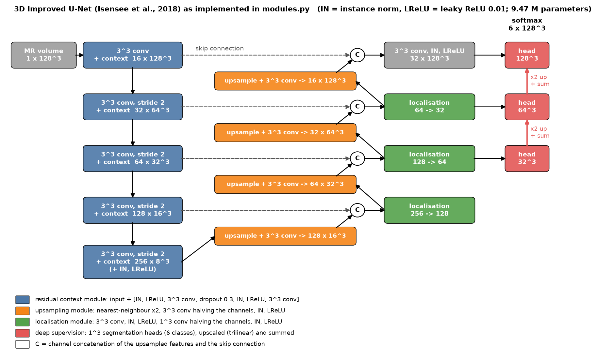

## Feasibility Review

*One-page review for the midpoint check-off, written before the full training runs. Their
outcomes are reported under [Results](#results) and in the dilemma section below.*

**1. User need, scope and acceptance criteria.** The user is a radiotherapy planner who
wants draft contours of the prostate and nearby organs at risk (bladder, rectum) plus body
and bone on pelvic MR, to review and correct rather than draw from scratch. The prototype must
show *where* a 3D model is safe to trust, not only its average Dice. It is accepted if:

| # | Criterion (held-out test set: 6 patients, 34 scans) |
|---|---|
| A1 | 3D Improved U-Net reaches Dice ≥ 0.70 on **each** of the 5 foreground classes. |
| A2 | Dilemma: on identical voxels, 3D context counts as a real gain only if prostate Dice in the apex and base thirds of the gland improves on the 2D U-Net by ≥ 0.05, or prostate HD95 drops (paired Wilcoxon over patients). |
| A3 | Prostate leaking into rectum and bladder (mL) and onto slices beyond the true apex/base is reported for both models; the recommendation does not rest on global Dice. |
| A4 | 3D training fits in ≤ 16 GB VRAM and ≤ 3 h on one A100; inference ≤ 1 s per volume; the 3D/2D cost ratio is reported. |
| A5 | No patient appears in two subsets; the split (`splits.json`) and seed are committed. |

**2. Model choice and course concepts.** 3D Improved U-Net (Isensee et al., 2018; Hard):
an encoder–decoder with skip connections, pre-activation residual context modules (dropout 0.3),
instance norm (batch size is only 2) and three summed deep-supervision heads; 9.47 M
parameters. The baseline is a 2D U-Net (Ronneberger et al., 2015; 7.76 M parameters)
trained on axial slices of the *same* volumes and restacked for evaluation, so the only difference is whether the convolutions see neighbouring slices (this later
turned out not to hold; see *A controlled comparison* below). Loss is cross-entropy +
foreground soft Dice for the severe class imbalance. Course concepts used: receptive fields
of 2D vs 3D convolutions, skip connections, residual learning, normalisation, loss design for
imbalance, and leakage-free evaluation.

**3. Preliminary evidence.**
*Data audit (Rangpur):* 211 scans from 38 patients (1–8 each); 256×256×128 voxels at
≈1.68×1.68×1.56 mm; prostate is 0.10 % and rectum 0.14 % of voxels; the prostate spans
17–41 axial slices (median 25). Volumes are resampled to 128×128×128, keeping every acquired
slice so the apex/base slices survive. Split stratified by scans per patient: 26/6/6 patients
(143/34/34 scans).
*Smoke tests:* the full pipeline (train → test → evaluation figures) runs end to end on
synthetic NIfTI data; on real data, 3 epochs on an A100 already give test Dice body 0.97,
bone 0.74, bladder 0.77, prostate 0.51, rectum 0.15.
*Measured cost:* 3D at 128³, batch 2: **4.0 GB** peak VRAM, **14 s/epoch** on an A100
(≈ 70 min for 300 epochs). On an RTX 4060, the 3D model needed 4.0 GB and 0.43 s per step, and
the 2D model 0.9 GB and 0.07 s per step (batch 32) — 4.4× less memory.

**4. Risks, budget and fallback.**

- *Tiny structures* (rectum, prostate) may miss 0.70 at half in-plane resolution → train at
  the native 128×256×256 (estimated 16 GB, fits an A100) and/or weight the cross-entropy.
- *Few patients* (26 for training; weekly scans are near-duplicates) → augmentation,
  dropout, model selection on validation patients only.
- *Low statistical power* (6 test patients) → report effect sizes and per-scan tests as well.
- *Shared-cluster queues* → short time limits, cache built on a CPU node, 20-min `a100-test`
  partition for smoke tests.

*Budget:* ≈ 1.2 A100-hours per 3D run; at most ~10 runs (≈ 15 GPU-hours) including tuning.
*Next experiment:* full 300-epoch 3D and 50-epoch 2D runs (queued), then the zone-wise
evaluation in `predict.py`. *Fallback:* if the 3D model still misses A1 by 22 Oct, switch to a
2D Improved U-Net (Normal) on the same pipeline; the 2D-vs-3D question can still be answered.

## Dataset and Pre-processing

**Data.** HipMRI Study [7, 8], on Rangpur at `/home/groups/comp3710/HipMRI_Study_open`: pelvic MR
volumes in `semantic_MRs/<patient>_Week<n>_LFOV.nii.gz` with labels in
`semantic_labels_only/<patient>_Week<n>_SEMANTIC.nii.gz`. `python dataset.py` audits it:

| Property | Value |
|---|---|
| Scans / patients | 211 / 38 — 22 patients with 8 weekly scans, 11 with 1, five with 2, 4, 5, 6 and 7 |
| Size (x, y, z) | 256 × 256 × 128 (one scan has 144 slices) |
| Voxel size | 1.41–1.88 mm in-plane (mostly 1.68), 1.56 mm slices; all LPS orientation |
| Labels | 0 background 60.35 %, 1 body 35.46 %, 2 bone 3.37 %, 3 bladder 0.57 %, 4 rectum 0.14 %, 5 prostate 0.10 % of voxels; no out-of-range values; every scan contains prostate |
| Prostate extent | 17–41 axial slices (median 25) |

**Pre-processing** (`dataset.py`), run once and cached as a single tensor file:

1. *Intensity:* each volume is z-score normalised. MR intensities have no physical unit and vary
   with scanner gain, so only relative contrast within a scan is meaningful.
2. *Resampling to 128 × 128 × 128 (D × H × W):* the 128 acquired slices are kept (the single
   144-slice scan is resampled to 128) and the in-plane grid is halved (voxels ≈ 3.4 mm in-plane, 1.56 mm between slices). With a median of 25 prostate slices, halving the
   slices as well would leave about four slices each for the apex and base — the very slices
   the research question is about. At this size the 3D model trains in 4 GB of GPU memory.
3. *Labels* are resampled by averaging their one-hot encoding over each output voxel and taking
   the arg-max, so a thin structure such as the rectal wall keeps the voxels it dominates;
   nearest-neighbour sampling would drop or keep it depending on where the grid points fall.

**Split.** Patients, not scans, are divided into train / validation / test (70 / 15 / 15 %,
seed 3710). A patient's weekly scans are nearly identical, so a scan-level split would put the
same anatomy in training and test and inflate the scores. Because scan counts per patient range
from 1 to 8, single-scan and multi-scan patients are split separately; a plain random split
gave test sets of 11 to 48 scans depending on the seed. The split is committed as
[`splits.json`](splits.json) so every run and every reviewer uses the same test patients:

| Subset | Patients | Scans |
|---|---|---|
| Train | 26 | 143 |
| Validation | 6 | 34 |
| Test | 6 (C032, M013, R016, R024, S035, T009) | 34 |

**Augmentation** (training only, applied identically to image and label): a left–right flip
(p = 0.5); a rotation of up to ±10° and a scaling by 0.9–1.1, both within the axial plane (p = 0.5); an
intensity gain of 0.9–1.1 and offset of ±0.1; and Gaussian noise with σ = 0.05 (p = 0.2). The
pelvis is roughly left–right symmetric, but anterior–posterior or superior–inferior flips would
put the rectum in front of the prostate or the bladder below it, so they are not used.

**2D model data.** Both 2D models are trained on the axial slices of the same cached volumes
(not the separate `keras_slices_data` set), and their slice predictions are stacked back into
volumes for evaluation. All models are therefore scored on exactly the same patients and
voxels.

## Usage

**Files.**

| File | Contents |
|---|---|
| `modules.py` | `ImprovedUNet3D`, its 2D twin `ImprovedUNet2D`, the `UNet2D` baseline and `DiceCELoss` (pure PyTorch) |
| `dataset.py` | file pairing, patient split, pre-processing and cache, augmentation, datasets, data audit |
| `utils.py` | model factory, checkpoint loading, whole-volume inference for 3D and 2D models, Dice / IoU |
| `train.py` | training, per-epoch validation, testing of the best checkpoint, loss and Dice curves |
| `predict.py` | evaluation of trained models (test or validation patients, optional post-processing) and all figures in this README |
| `seeds.py` | mean ± SD over seeds and seed-averaged paired tests, from `predict.py`'s outputs |
| `slurm/*.sh` | Rangpur batch jobs: `prepare_data.sh` (CPU), `train.sh` and `predict.sh` (one A100) |
| `splits.json` | the committed patient split |
| `requirements.txt` | the exact package versions above |

**Dependencies.** Versions used for all reported results (conda environment on Rangpur,
NVIDIA A100-PCIE-40GB):

| Package | Version |
|---|---|
| Python | 3.11.15 |
| PyTorch | 2.13.0 (CUDA 13.0 build) |
| nibabel | 5.4.2 |
| NumPy | 2.4.6 |
| SciPy | 1.17.1 |
| Matplotlib | 3.11.1 |

`pip install -r requirements.txt` installs exactly these versions (install a PyTorch build that
matches your CUDA version first if needed). The model code (`modules.py`) uses only
PyTorch; NumPy and SciPy are used in `predict.py` for evaluation and plotting.

**Running on Rangpur.** From this folder (Slurm does not create the log folder itself):

```bash
mkdir -p logs
sbatch slurm/prepare_data.sh                     # audit, splits.json and cache on a CPU node
sbatch -J unet3d slurm/train.sh --model unet3d           # 3D Improved U-Net
sbatch -J improved2d slurm/train.sh --model improved2d   # same network in 2D
sbatch -J unet2d slurm/train.sh --model unet2d           # standard 2D U-Net
sbatch slurm/predict.sh --checkpoints runs/unet3d/best.pt runs/improved2d/best.pt runs/unet2d/best.pt
sbatch slurm/predict.sh --checkpoints ... --split val --out images_val           # validation patients
sbatch slurm/predict.sh --checkpoints ... --postprocess lcc --out images_lcc     # largest component
# further seeds: train.sh ... --seed 3711 --out runs_s3711, then predict.sh ... --out images_s3711
python seeds.py images/results.json images_s3711/results.json images_s3712/results.json
```

The scripts forward their arguments to the Python files, which can also be run directly, e.g.
`python train.py --model unet3d --root <HipMRI_Study_open>`. The batch scripts set
`--account=comp3710` (required by the `comp3710` partition) and deliberately request no
`--mem`, which Rangpur's nodes can never satisfy.

| `train.py` option | Default | Meaning |
|---|---|---|
| `--model` | `unet3d` | `unet3d`, `improved2d` or `unet2d` |
| `--epochs`, `--batch-size`, `--lr` | 300, 2, 5e-4 (3D); 50, 32, 5e-4 (2D Improved); 50, 32, 1e-3 (2D U-Net) | optimisation |
| `--shape` | `128x128x128` | volume size D × H × W after resampling (multiples of 16) |
| `--root`, `--cache`, `--out` | Rangpur data path, `cache`, `runs` | input, pre-processed cache, outputs |
| `--weight-decay`, `--seed`, `--workers` | 1e-5, 3710, 4 | |
| `--no-amp` | off | disable mixed precision |
| `--limit N` | – | use only N scans per subset, for smoke tests |

Training uses AdamW [5] with cosine learning-rate decay [6] and mixed precision. After every epoch the
model segments each whole validation volume, and the checkpoint with the highest mean foreground
Dice is kept as `best.pt`. `train.py` writes `best.pt`, `last.pt`, `history.json`, `curves.png`
(loss and per-class validation Dice) and `test_metrics.json` to `runs/<model>/`. `predict.py`
writes the figures and a per-scan `results.json` to `images/` (the JSON is not committed:
the repository holds only code and the README figures); with several checkpoints, the first is
the main model and is compared with each of the others.

**Reproducibility.** The split is fixed by `splits.json`, the seed by `--seed`, and the cache
is rebuilt automatically if the shape or the number of scans changes. GPU convolutions and mixed
precision are not bit-for-bit deterministic, so repeated runs differ slightly. A quick check
of the whole pipeline takes a few minutes:
`python train.py --model unet3d --epochs 1 --limit 2`.

## Results

Three models were trained on the same patients and evaluated on the same voxels: the 3D
Improved U-Net, the **2D Improved U-Net** (the identical network with 2D convolutions, so it
differs only in seeing neighbouring slices) and the standard **2D U-Net**. Each was trained with
three seeds (3710, 3711, 3712). Tables give the mean ± standard deviation over the seeds, each
seed's value being the mean over the 34 test scans of the 6 test patients, at 128 × 128 × 128 on
one NVIDIA A100-PCIE-40GB. Figures show seed 3710.

**Training.** The 3D model's mean foreground validation Dice peaks at epoch 100 (0.912) and then
drifts down slightly while its training loss keeps falling — mild over-fitting that selecting
the best checkpoint absorbs. The 2D models peak early (2D Improved at epoch 19, 2D U-Net at
epoch 15). They were not under-trained: 50 2D epochs are 28,600 gradient steps (572 batches of 32
slices per epoch), more than the 21,300 steps of the 3D model's 300 epochs.

*3D Improved U-Net:*

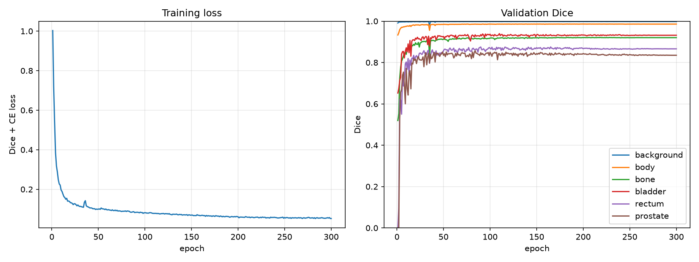

*2D Improved U-Net:*

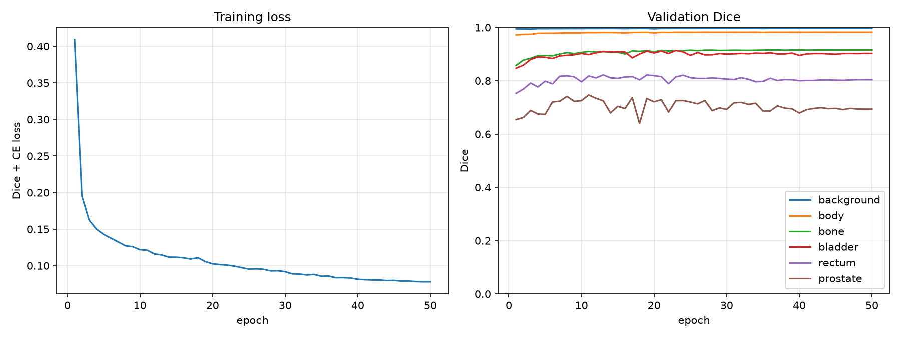

*2D U-Net:*

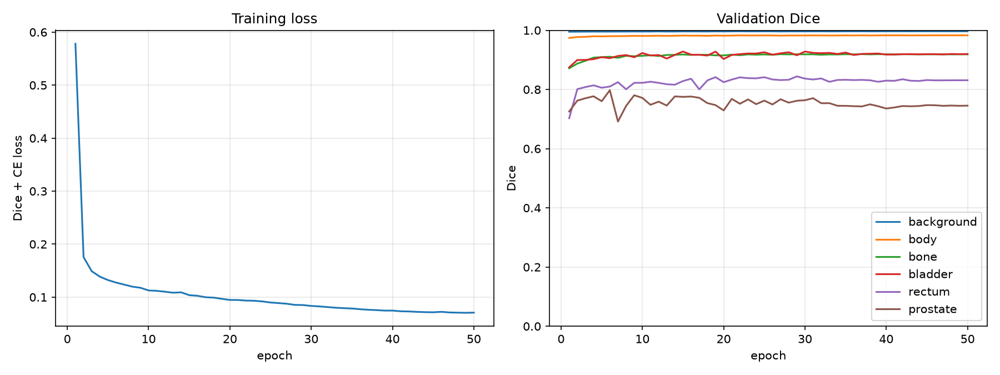

**Segmentation accuracy** (test Dice, mean ± SD over three seeds / IoU; the 3D model is best on
every class, and bold marks the classes where it leads both 2D models by more than 0.02):

| Class | 3D Improved U-Net | 2D Improved U-Net | 2D U-Net |
|---|---|---|---|
| Body | 0.988 ± 0.000 / 0.976 | 0.984 ± 0.001 / 0.969 | 0.985 ± 0.000 / 0.971 |
| Bone | 0.919 ± 0.001 / 0.850 | 0.912 ± 0.002 / 0.838 | 0.917 ± 0.001 / 0.847 |
| Bladder | **0.958 ± 0.003** / 0.920 | 0.935 ± 0.002 / 0.882 | 0.943 ± 0.004 / 0.894 |
| Rectum | **0.886 ± 0.006** / 0.797 | 0.856 ± 0.000 / 0.750 | 0.864 ± 0.014 / 0.762 |
| Prostate | 0.872 ± 0.004 / 0.775 | 0.863 ± 0.005 / 0.761 | 0.859 ± 0.005 / 0.755 |

Every model clears 0.70 Dice on every class of every test scan for every seed (the lowest single
value is 0.712, a bladder). The 3D model is the most consistent across seeds; the 2D U-Net's
rectum Dice alone varies by 0.026 between seeds, so one seed would not have been enough.

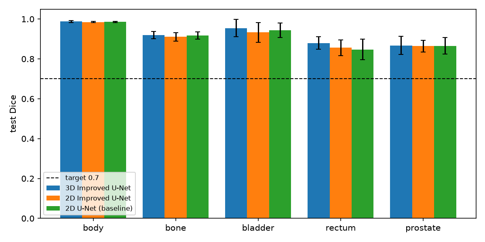

*Seed 3710: bars are means over the 34 test scans and error bars the standard deviation over
scans, which is much larger than the seed-to-seed variation in the table.*

**Example inputs and outputs** — the first scan of three test patients, axial slice through the
centre of the prostate (anterior up) and sagittal slice (superior up). Colours: bone white,
bladder yellow, rectum brown, prostate red.

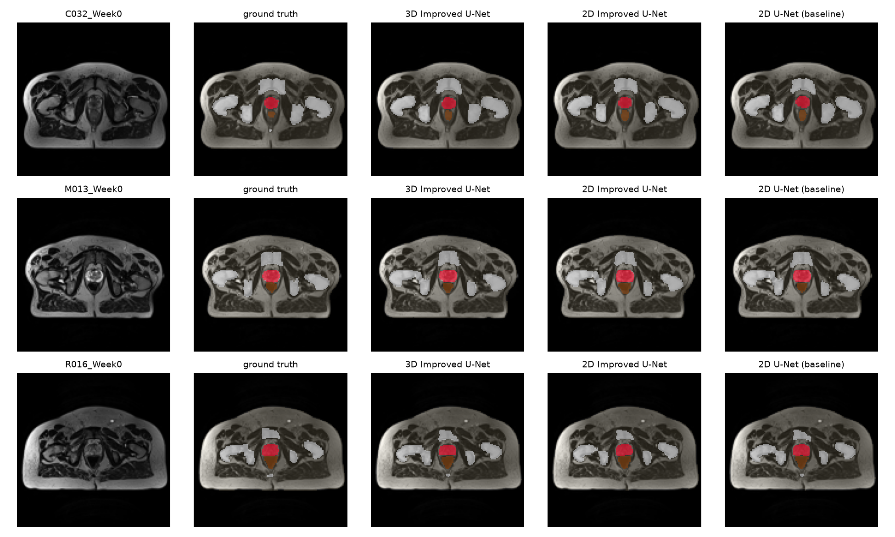

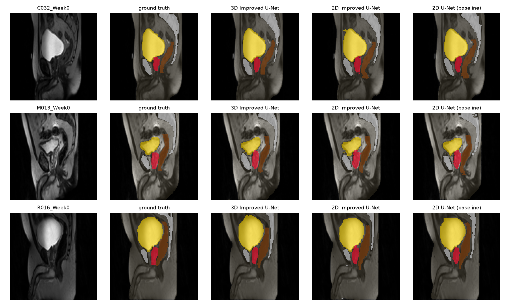

The models are hard to tell apart in the axial view. The sagittal view, which cuts across the
slices the 2D models segment independently, shows their outlines to be slightly more ragged
from slice to slice.

**Resources** (seed 3710; mixed precision; batch 2 volumes for 3D, 32 slices for 2D):

| | 3D Improved U-Net | 2D Improved U-Net | 2D U-Net |
|---|---|---|---|
| Parameters | 9.47 M | 3.19 M | 7.76 M |
| Training time | 1.12 h (300 epochs) | 0.27 h (50 epochs) | 0.23 h (50 epochs) |
| Peak training VRAM | 4.04 GB | 0.70 GB | 0.92 GB |
| Inference latency per volume | 0.034 s | 0.031 s | 0.027 s |
| Peak inference VRAM | 1.02 GB | 0.48 GB | 0.51 GB |

The 3D model costs about four to six times the training time and memory of either 2D model,
at the lower end of the "5–10×" cost the dilemma assumes; at inference all three segment a volume in a
few hundredths of a second.

**Acceptance criteria** (from the feasibility review):

| # | Criterion | Outcome |
|---|---|---|
| A1 | 3D Dice ≥ 0.70 on each foreground class | **Met** for every class, scan and seed |
| A2 | 3D context improves apex and base Dice by ≥ 0.05, or lowers prostate HD95 | **Not met** on the test patients, against either baseline: vs the 2D U-Net named in the plan, apex −0.021, base +0.023, HD95 −0.12 mm (p = 0.84 over patients); vs the 2D Improved U-Net, apex −0.045, base +0.010, HD95 +0.10 mm. See the dilemma section for the validation patients |
| A3 | Leakage into rectum and bladder and beyond the gland is reported | **Met** |
| A4 | ≤ 16 GB VRAM and ≤ 3 h training on one A100; inference ≤ 1 s | **Met** at 128³ (4.0 GB, 1.1–1.2 h, 0.03 s) |
| A5 | No patient in two subsets; split and seed committed | **Met** |

## Open Research Dilemma: Spatial Context vs. Clinical Boundary Utility

A planner does not care about the average overlap of a contour but about where it is wrong:
at the apex and base, where the prostate meets the pelvic floor and the bladder neck, and at
the thin interface with the rectum. The brief asks whether 3D context genuinely removes these
boundary errors or merely smooths easy central slices "while demanding 5–10× the GPU memory and
training time".

**A controlled comparison.** The feasibility plan treated the 2D U-Net as differing from the 3D
model only in through-plane context. That is not true: the two also differ in residual blocks,
instance vs batch normalisation, deep supervision and width, so any gain of the 3D model over
the 2D U-Net could come from the architecture. The **2D Improved U-Net** removes that
confound — it is the same network with 2D convolutions — and is the comparison used below; the
2D U-Net is kept as the conventional baseline.

**Order of the analysis.** The 2D Improved U-Net, the extra seeds, the post-processing control and
the native-resolution experiment were all added after the first test results had been seen, so
the test set was reused. They were chosen to challenge the 3D model's lead — a stronger 2D
baseline of the same design and a free clean-up of the 2D output — not to favour it. They shrank
most of it (the prostate and base gains over the 2D U-Net roughly halve against the 2D Improved
U-Net, and much of the HD95 gap turns out to be fragments), although the rectum gap widened.
The validation patients give a second look below.

### Global Dice hides the boundary failures

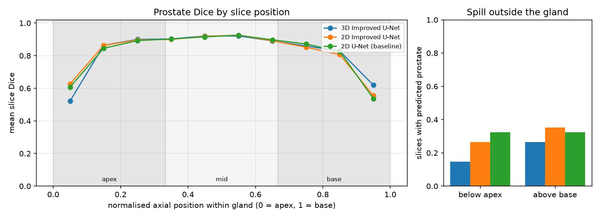

Each axial slice of each test scan is placed by its relative position in the true gland
(0 = apex, 1 = base) and scored separately. All three models reach about 0.91 Dice in the middle
third but only 0.75–0.82 in the apex and base thirds (across seeds), and roughly 0.5–0.6 on the outermost tenth
of the slices. A global prostate Dice of 0.87 therefore averages a near-perfect mid-gland with
end slices where about half of the contour is wrong. The right panel shows, for the three slices
just beyond each end of the true gland, the fraction on which prostate is predicted; the tables
below instead count such slices per scan.

### Paired comparison on the test patients

Per-scan metrics are first averaged over the three seeds (`seeds.py`), then compared on the same
34 scans; difference = 3D − 2D; two-sided Wilcoxon signed-rank tests over scans and over the 6
patient means. The per-patient test is the honest one, since a patient's weekly scans are
correlated; with 6 patients its smallest possible p is 0.031.

| Metric | 3D | 2D Improved | 3D − 2D Improved | p (scans) | p (patients) | 3D − 2D U-Net | p (patients) |
|---|---|---|---|---|---|---|---|
| Prostate Dice | 0.872 | 0.863 | +0.009 | 0.057 | 0.69 | +0.013 | 0.16 |
| Prostate apex-third Dice | 0.771 | 0.816 | −0.045 | 0.001 | 0.44 | −0.021 | 1.00 |
| Prostate base-third Dice | 0.768 | 0.757 | +0.010 | 0.49 | 0.84 | +0.023 | 0.22 |
| Prostate HD95 (mm) | 4.27 | 4.17 | +0.10 | 0.52 | 0.56 | −0.12 | 0.84 |
| Slices with prostate beyond the gland | 1.13 | 2.39 | −1.27 | < 0.001 | 0.31 | −0.91 | 0.44 |
| Prostate over-contoured (mL) | 5.32 | 5.79 | −0.47 | 0.16 | 0.69 | −0.37 | 0.44 |
| Prostate missed (mL) | 2.99 | 3.03 | −0.05 | 0.70 | 0.84 | −0.30 | 0.56 |
| **Rectum Dice** | **0.886** | **0.856** | **+0.030** | < 0.001 | **0.031** | +0.023 | 0.062 |
| Rectum HD95 (mm) | 4.24 | 8.09 | −3.85 | < 0.001 | 0.031 | −1.10 | 0.22 |
| Bladder HD95 (mm) | 3.17 | 7.47 | −4.30 | < 0.001 | 0.062 | −4.44 | 0.062 |

These are 20 per-patient tests on 6 patients and no correction for multiple comparisons is
applied; with a Bonferroni correction none of the per-patient tests would be significant (the
per-scan tests treat correlated weekly scans as independent and overstate the evidence). They are read as consistent or
inconsistent directions, not as proof.

- **Typical patients: context does not improve the prostate.** On the test patients the 3D
  model's prostate Dice equals that of the 2D Improved U-Net within 0.01, its base is no better,
  and it is consistently *worse* at the apex in all three seeds (0.771 vs 0.816). A prostate
  HD95 difference of 0.1 mm is far below one 3.4 mm voxel and carries no meaning.
- **Context does keep the prostate contained.** The 3D model predicts prostate on about one
  slice beyond the true gland per scan, against more than two for either 2D model, in every
  seed.
- **The rectum is the most consistent gain:** +0.030 Dice over the 2D Improved U-Net, better in
  all six test patients, and +0.023 over the 2D U-Net.
- **Much of the HD95 gap is stray fragments** — see the post-processing control below.

### Validation patients: context prevents the worst failures

Evaluating the same checkpoints on the six validation patients (`predict.py --split val`) gives
a different picture. The validation set was used to choose each model's best epoch, which
favours every model equally but means these numbers are not a clean held-out estimate.

| Validation (mean over seeds) | 3D | 2D Improved | 2D U-Net |
|---|---|---|---|
| Prostate Dice | **0.847** | 0.745 | 0.777 |
| Prostate base-third Dice | **0.683** | 0.571 | 0.585 |
| Prostate missed (mL) | **6.2** | 12.0 | 10.4 |
| Rectum Dice | **0.874** | 0.823 | 0.831 |
| Patient G021, prostate Dice | **0.847** | 0.629 | 0.716 |
| Patient N010, prostate Dice | **0.863** | 0.691 | 0.753 |

The gap comes almost entirely from two patients, G021 and N010, in whom both 2D models miss large
parts of the gland — mostly at the base — while the 3D model stays close to its usual accuracy;
on the other four validation patients the three models are within about 0.07 of each other and
the 3D model is not always best. Because only two of the twelve patients not used for training
are affected, the per-patient tests over the six validation patients are not significant
(Wilcoxon on patient means, p = 0.31 for prostate Dice against the 2D Improved U-Net).

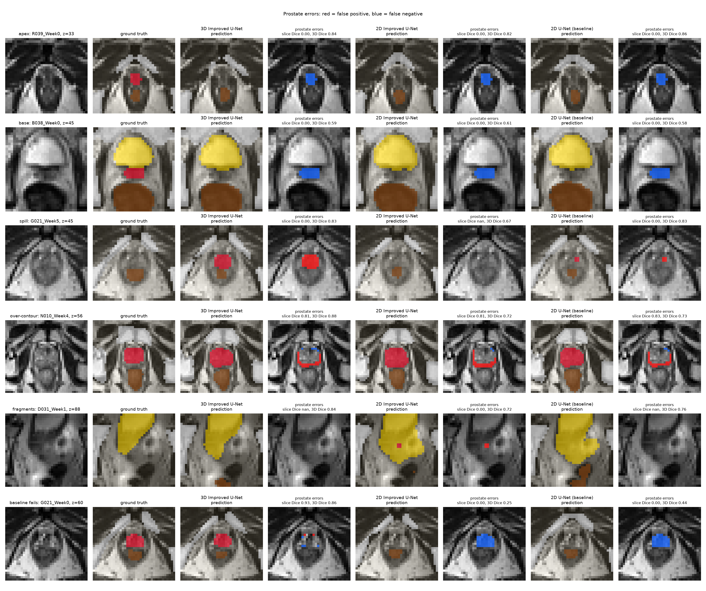

The bottom row (*baseline fails*, G021 week 0) shows the effect: on a slice where the gland's
texture is uneven, the 3D model outlines it almost perfectly (slice Dice 0.93) while both 2D
models label none of it, because neither can see that the same structure continues on the
neighbouring slices.

### Post-processing control: largest connected component

A slice-wise model's stray fragments could be removed by keeping only the largest connected
piece of each organ. `predict.py --postprocess lcc` does this for bladder, rectum and prostate
(not bone, whose pelvis and femoral heads are legitimately separate pieces), giving removed
voxels to their next most likely class. Since a deployed pipeline would include this free step,
these are the numbers that matter (all three seeds, seed-averaged, 3D vs 2D Improved U-Net):

| Test set | Without post-processing | With post-processing | p (patients), with |
|---|---|---|---|
| Rectum HD95 difference (mm) | −3.85 | −1.63 | 0.13 |
| Bladder HD95 difference (mm) | −4.30 | −2.73 | 0.062 |
| Slices with prostate beyond the gland (3D vs 2D Improved) | 1.13 vs 2.39 | 1.09 vs 2.37 | 0.31 |
| Rectum Dice difference | +0.030 | +0.030 | 0.031 |
| Prostate Dice difference | +0.009 | +0.010 | 0.56 |

Post-processing removes much of the 3D model's HD95 advantage — that part was fragments — but
not all of it. The 3D model's lower spill beyond the gland is untouched (spill is the gland
extending, not a separate piece), and so is its rectum Dice lead, still better in all six test
patients.

### Failure autopsy

One test case per failure type, chosen automatically by `predict.py` (seed 3710) from a different
patient where possible (red = false positive, blue = false negative prostate):

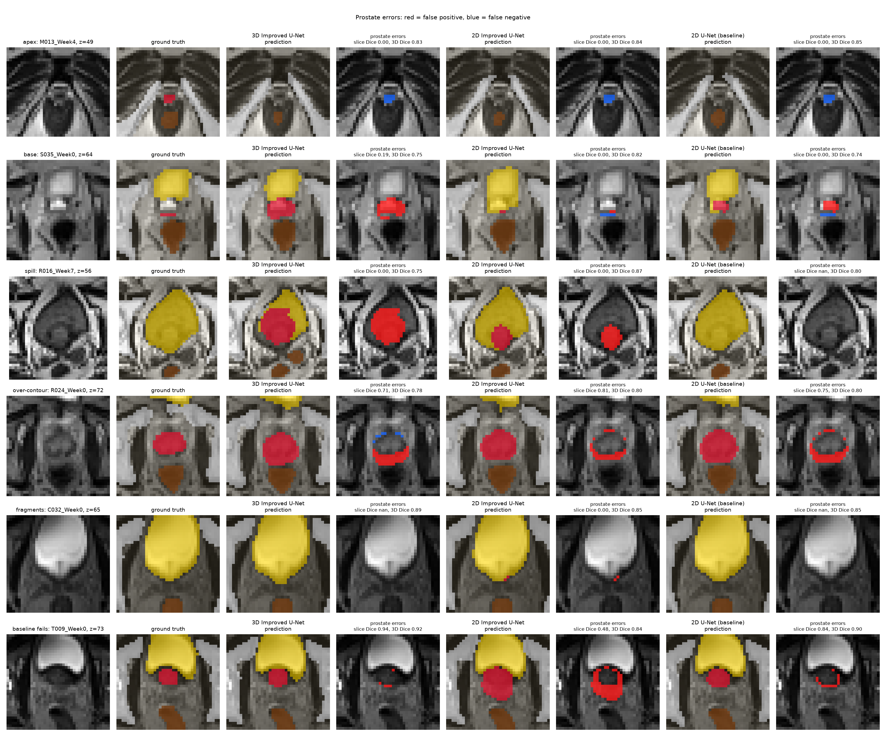

1. **Apex — M013 week 4, slice 49.** The true apex is a 3–4-voxel island in front of the rectum;
   all three models miss it completely. At 3.4 mm in-plane voxels the tapering apex is barely
   resolvable, and the neighbouring slices cannot help because the gland vanishes there too.
   *Trigger: resolution and partial volume, not missing context.*
2. **Base — S035 week 0, slice 64.** The single-scan patient with the smallest gland in the test
   set (17.5 mL). At the base the reference is a one-voxel strip under the bladder; the 3D model
   paints a blob the image does not separate from the bladder neck, and the 2D U-Net also over-draws. *Trigger: a bladder-neck boundary the annotator judged but the intensities do not show.*
3. **Spill into the bladder — R016 week 7, slice 56.** On a slice above the gland the 3D model
   labels a large central region of the bladder as prostate (21.3 mL over-contoured in this
   scan), and the 2D Improved U-Net a smaller one, while the 2D U-Net is correct. The patient's
   other weeks are unremarkable; in week 7 the bladder contents are darker and heterogeneous.
   *Trigger: an unusual bladder appearance that the Improved architecture — in both 2D and 3D —
   carries upwards from the gland below; not specific to 3D context.*
4. **Over-contouring — R024 week 0, slice 72.** In mid-gland all three models draw almost the
   same outline, larger than the reference and mostly towards the rectum. The reference gland in
   this week is 30.9 mL, 21 % below the median of the patient's other seven weeks (39.1 mL), on
   which the models score 0.86–0.91. Either this contour was drawn tighter or the gland swelled
   during treatment; either way no architecture can learn it from the image. *Trigger: variation
   in the reference contour or the anatomy, in the clinically worst direction (rectal wall).*
5. **Fragments — C032 week 0, slice 65.** Above the base the 2D Improved U-Net places a tiny
   prostate island on the floor of the bladder, one of four separate pieces in this scan; the 3D
   model has none. This is the error that through-plane context prevents — and that a largest-component step also removes.
6. **2D model fails — T009 week 0, slice 73.** At the base the 2D Improved U-Net extends the
   gland far beyond its boundary (slice Dice 0.48), while the 3D model follows it closely (0.94).
   A milder version of the validation failures above.

### Is resolution the bottleneck rather than context?

If the ends of the gland fail because a 3.4 mm in-plane voxel is too coarse, more resolution
should help where context did not. All three models were retrained at the native
128 × 256 × 256 grid (1.68 mm in-plane) with identical settings (`prepare_data.sh --shape
128x256x256`, then `train.sh ... --out runs_native`, seed 3710 only). This experiment was added
after the first test-set results had been seen, so it is exploratory. Each resolution is scored
against its own resampled labels, so the two sets of numbers are comparable in direction but
not to the third decimal.

| Prostate (test set, seed 3710) | 3D 128³ | 3D native | 2D Impr. 128³ | 2D Impr. native | 2D U-Net 128³ | 2D U-Net native |
|---|---|---|---|---|---|---|
| Dice, whole gland | 0.868 | 0.874 | 0.865 | 0.866 | 0.865 | 0.865 |
| Dice, apex third | 0.762 | 0.773 | 0.795 | 0.811 | 0.781 | **0.841** |
| Dice, base third | 0.776 | 0.741 | 0.751 | 0.773 | 0.758 | 0.762 |
| Slices with prostate beyond the gland | 1.24 | **1.00** | 1.85 | 2.59 | 1.94 | 2.88 |
| Rectum Dice | 0.880 | **0.894** | 0.856 | 0.875 | 0.847 | 0.875 |
| Lowest single-scan Dice, any class | 0.712 | 0.651 | 0.765 | 0.740 | 0.724 | 0.725 |
| Training time / peak VRAM | 1.1 h / 4.0 GB | 4.4 h / 15.8 GB | 0.27 h / 0.7 GB | 1.0 h / 2.7 GB | 0.23 h / 0.9 GB | 0.8 h / 3.3 GB |

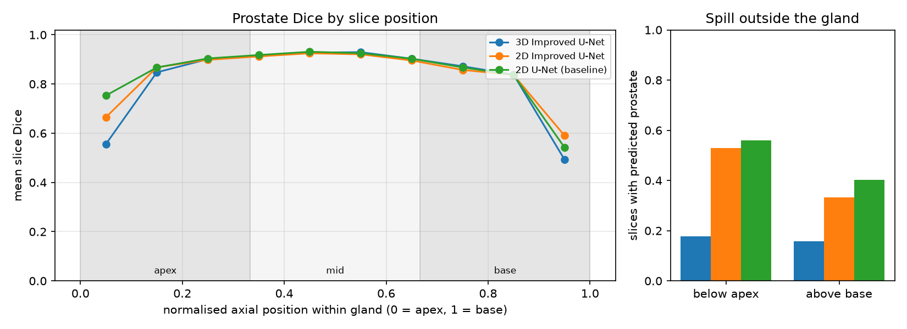

- **Only the 2D U-Net's apex clearly responds to resolution** (+0.060). The 2D Improved U-Net
  (+0.016) and the 3D model (+0.011) barely change, so resolution is not a general fix for the
  apex either. The 2D U-Net's apex gain is also partly an operating point: at native resolution
  the 2D models reach the last apex slices but paint prostate on more than half of the slices
  just below the apex, while the 3D model stops early and rarely spills.
- **The base does not improve consistently** (3D −0.035, 2D Improved +0.022, 2D U-Net +0.004).
- **The rectum improves with resolution for all three models**, and the 3D model keeps its lead
  (+0.018 over the 2D Improved U-Net; rectum HD95 −1.5 mm, p = 0.031 over patients), as it does
  for containment (1.0 vs 2.6 slices beyond the gland).
- **Native 3D is not worth its cost:** 4.4 h of training exceeds the 3 h budget of criterion A4,
  it needs a 16 GB GPU, and it is the only configuration with a test scan below 0.70 (bladder
  0.651).

### Recommendation to the project manager

1. **Use the 3D Improved U-Net at 128³ as the drafting model.** Against a 2D network of the same
   design it gives better rectum contours in every test patient, keeps the prostate inside the
   gland more often, and — the most clinically important point, though it rests on two patients —
   did not collapse on the two validation
   patients where both 2D models missed large parts of the gland. Its cost is training-only:
   about one GPU-hour and 4 GB on one A100; inference is a few hundredths of a second for any
   model.
2. **Do not expect 3D context to improve the prostate on typical patients.** On the test
   patients its prostate Dice equals that of the 2D Improved U-Net, its apex is worse, and much of its
   HD95 advantage over the 2D models is stray fragments that a largest-component step
   removes. Its value is robustness on atypical anatomy, not a better average.
3. **Always post-process with a largest-connected-component step**, whichever model is used: it
   is free and removes stray pieces.
4. **Keep a human in the loop at the ends of the gland.** Unsuitable for automatic drafting
   without review: the apex and base thirds of the prostate (in particular the first and last
   two or three slices); the bladder neck when the bladder looks unusual (case 3); small glands
   (case 2); and any scan where the models disagree strongly, which can be flagged
   automatically by running a 2D model alongside.
5. **Check the reference contours before more model work.** One week's reference gland is 21 %
   smaller than the same patient's other weeks (case 4), and patient C032's reference grows by
   42 % over treatment. Contouring consistency, or genuine swelling, limits every model here.
6. **Consider a 2.5D model next.** Feeding a 2D network a few neighbouring slices as input
   channels would give some through-plane context at close to 2D cost — a natural middle ground
   for this trade-off that was not tested here.
7. **Treat these results as indicative.** They rest on six test and six validation patients and
   uncorrected tests; a cross-validated study over all 38 patients would be needed before
   clinical use.

## Artificial Intelligence Usage Disclosure

I used Anthropic's Claude (Claude Code, model Claude Opus 5.5) throughout this project: to
help plan the experiments, write and debug the code and Slurm scripts, submit and monitor the
jobs on Rangpur, analyse the results, draw the figures and draft this README. Every commit it
contributed to carries a `Co-Authored-By: Claude` trailer.

The work was checked in several ways. The whole pipeline was first run on synthetic NIfTI
volumes with known anatomy. An audit of the real data contradicted an assumed file-name format,
and the loader was corrected before any training. The patient split was recomputed on a second
machine and matched exactly. The architecture figure and parameter counts were compared with
`modules.py`, and a faster surface-distance routine was compared with the original on 60 random
cases, giving identical results. Every number in this README was checked against the saved
evaluation outputs, which caught and corrected several transcription errors, and the dataset
references were checked against their DOIs.

These checks were also carried out with AI assistance. I remain responsible for reviewing and
understanding the submitted work.

## Acknowledgements

Data were provided by the HipMRI Study [7], acquired at Calvary Mater Newcastle Hospital in a
retrospective MRI-alone radiation therapy study [8], and used under its data use agreement
(non-commercial; no attempt to identify participants).

## References

1. F. Isensee, P. Kickingereder, W. Wick, M. Bendszus and K. H. Maier-Hein, "Brain tumor
   segmentation and radiomics survival prediction: Contribution to the BRATS 2017 challenge," in
   *Brainlesion: Glioma, Multiple Sclerosis, Stroke and Traumatic Brain Injuries*, 2018,
   pp. 287–297.
2. O. Ronneberger, P. Fischer and T. Brox, "U-Net: Convolutional networks for biomedical image
   segmentation," in *Proc. MICCAI*, 2015, pp. 234–241.
3. F. Milletari, N. Navab and S.-A. Ahmadi, "V-Net: Fully convolutional neural networks for
   volumetric medical image segmentation," in *Proc. 3DV*, 2016, pp. 565–571.
4. D. Ulyanov, A. Vedaldi and V. Lempitsky, "Instance normalization: The missing ingredient for
   fast stylization," arXiv:1607.08022, 2016.
5. I. Loshchilov and F. Hutter, "Decoupled weight decay regularization," in *Proc. ICLR*, 2019.
6. I. Loshchilov and F. Hutter, "SGDR: Stochastic gradient descent with warm restarts," in
   *Proc. ICLR*, 2017.
7. J. Dowling and P. Greer, "Labelled weekly MR images of the male pelvis," v1, CSIRO Data
   Collection, 2021. https://doi.org/10.25919/45t8-p065
8. J. A. Dowling et al., "Automatic substitute computed tomography generation and contouring
   for magnetic resonance imaging (MRI)-alone external beam radiation therapy from standard MRI
   sequences," *Int. J. Radiat. Oncol. Biol. Phys.*, vol. 93, no. 5, pp. 1144–1153, 2015.
   https://doi.org/10.1016/j.ijrobp.2015.08.045
